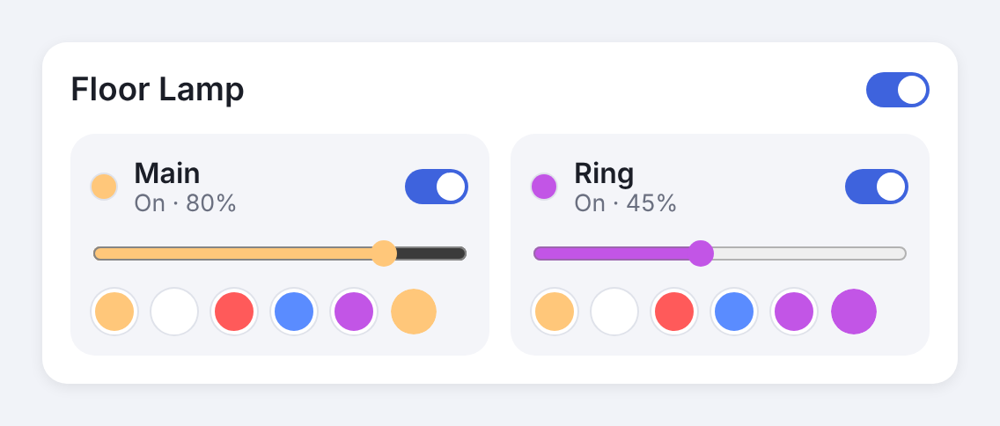

# Undumb Govee

A Home Assistant integration for Govee lamps that have **more than one light
inside them**. Examples are the Floor Lamp 2's main light and LED ring, or a desk
lamp with a nightlight.

Govee's own integration, Matter and Apple Home show these lamps as one light, so
the second light can't be controlled on its own. Undumb Govee gives every light
its own entity:

| Entity | What it controls |
| --- | --- |
| `light.floor_lamp` | The whole lamp: power, brightness, colour, colour temperature, Govee scenes (as effects) |
| `light.floor_lamp_main` | Only the main light: on/off, brightness, colour |
| `light.floor_lamp_ring` | Only the ring: on/off, brightness, colour |



The design mockups are in [`docs/mockups/index.html`](docs/mockups/index.html),
and the project brief is in [`docs/BRIEF.md`](docs/BRIEF.md).

## How it works

The integration uses the official **Govee Platform API v2**. Each lamp reports
what it can do, and Undumb Govee reads that to find the separate lights:

- **Segment lamps** (most RGBIC lamps) report a strip of numbered segments.
  Each light is a range of those segments. Turning such a light "off" sets its
  segments to brightness 0. Turning it back on restores the last brightness.
  If you switch off every light, the whole lamp powers down. If you turn on one
  light of a dark lamp, the other lights stay dark.
- **Toggle lamps** report the second light as its own switch, for example
  `nightlightToggle`. That becomes an on/off light entity.

## Install

### HACS (recommended)

1. HACS → ⋮ → **Custom repositories** → add `https://github.com/kirikakaese/undumb-govee`, category **Integration**.
2. Install **Undumb Govee** and restart Home Assistant.

### Manual

Copy `custom_components/undumb_govee` into your `config/custom_components/`
folder and restart Home Assistant.

## Set up

1. Get an API key: in the **Govee Home** app go to **Profile → Settings →
   Apply for API Key**. Govee emails it to you within a few minutes.
2. In Home Assistant: **Settings → Devices & services → Add integration →
   Undumb Govee**, then paste the key.
3. Pick your lamps. Lamps with more than one light are preselected.

### Map the lights (segment lamps)

Undumb Govee can't know where one light ends and the next begins, so at first
it splits the segments in half. The Floor Lamp 2 is named "Main" and "Ring";
other lamps get "Main" and "Second". To fix the split:

1. Open **Settings → Devices & services → Undumb Govee → Configure → Map a
   lamp's lights to segments**.
2. Pick the lamp. The form shows how many segments it reports.
3. Give each light a name and a segment range, for example `0-9` for Main and
   `10-14` for Ring. You can set up to 4 lights.

To find the boundary, set one light to red in **Developer tools → Actions**
(`light.turn_on` with `rgb_color: [255, 0, 0]`) and see which part of the lamp
turns red. Adjust and repeat.

## Dashboard card

The card is bundled and loads automatically. You don't need to add a resource.

```yaml
type: custom:undumb-govee-card
entity: light.floor_lamp        # the whole-lamp entity
# title: Living room lamp       # optional
# swatches: ["#ffc77a", "#ffffff", "#ff5a5a", "#5a8cff", "#c255e6"]   # optional
```

It finds the lamp's lights by itself and shows a switch, brightness slider and
colour swatches for each one.

## Apple Home

1. Add Home Assistant's built-in **HomeKit Bridge** integration if you don't have it yet.
2. In its options, include the new `light.*_main` / `light.*_ring` entities.
   Include the whole-lamp entity too if you want it.
3. Each light shows up as its own tile in the Home app, and Siri can control it
   ("turn on the ring light").

If the lamp is also paired to Apple Home directly through Matter, you'll see a
duplicate tile. Remove the Matter one or hide it in a room you don't use.

## Rate limits

Govee allows about **10,000 API requests per day** per key. Undumb Govee makes
one state request per lamp per refresh. At the default of 60 seconds that's
1,440 requests per lamp per day. With more than about 5 lamps, raise the
refresh interval under **Configure → Lamps and refresh interval**. Commands
update the UI right away and don't wait for the next refresh.

## Troubleshooting

- **No separate lights for my lamp.** The lamp doesn't report segments or a
  light toggle through Govee's API, so there's nothing for the integration to
  address. Download diagnostics from the device page and open an issue with
  them. The API key is removed from the file automatically.
- **The light I switched off flickers back on after a moment.** Something else,
  such as a Govee app scene or schedule, rewrote the segments. Segment state is
  tracked by Home Assistant because Govee doesn't report it back.
- **"Govee's rate limit was reached."** Wait a minute, and consider a longer
  refresh interval.

## Development

```bash
pip install -r requirements_test.txt
pytest
```

The pure logic lives in `zones.py` (capability parsing, light mapping, colour
maths) and `api.py` (HTTP client). Neither imports Home Assistant.
