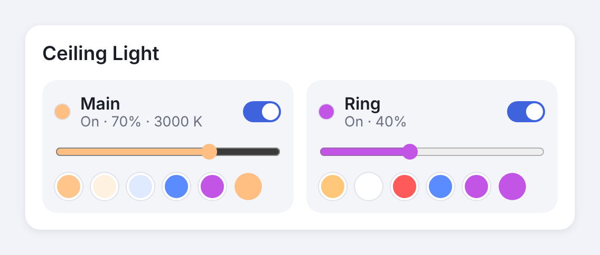

# Undumb Govee

A Home Assistant integration for Govee lamps that have **more than one light
inside them**. Examples are the H60A4 Square Ceiling Light's main panel and edge ring,
the Floor Lamp 2's main light and LED ring, or a desk lamp with a nightlight.

Govee's own integration, Matter and Apple Home show these lamps as one light, so
the second light can't be controlled on its own. Undumb Govee gives every light
its own entity:

| Entity | What it controls |
| --- | --- |
| `light.floor_lamp` | The whole lamp: power, brightness, colour, colour temperature, Govee scenes (as effects) |
| `light.floor_lamp_main` | Only the main light: on/off, brightness, colour |
| `light.floor_lamp_ring` | Only the ring: on/off, brightness, colour |



The design mockups are in [`docs/mockups/index.html`](docs/mockups/index.html),
and the project brief is in [`docs/BRIEF.md`](docs/BRIEF.md).

## Supported lamps

Any Govee light that reports segments or a separate light switch to Govee's API
works. These models have presets:

| Model | Lamp | Default layout |
| --- | --- | --- |
| H60A4 | Square Ceiling Light (30 cm, RGBWW panel + RGBIC edge) | Main light + ring |
| H60A1 | Ceiling Light | Main light + ring |
| H60A0 | Ceiling Light Pro | Main light + ring |
| H607C | Floor Lamp 2 | Split segments: Main + Ring |

Every other lamp starts with "split segments" and two lights, and you can change
that. If your lamp works with a different layout or split, please open an issue
with your diagnostics so it can become a preset.

## How it works

The integration uses the official **Govee Platform API v2**, plus Govee's **LAN
API** when LAN control is on. Each lamp reports what it can do, and Undumb Govee
reads that to find the separate lights. There are two layouts:

- **Main light + ring** (ceiling lights). The lamp's own power, brightness,
  colour and colour temperature drive the main panel, and the segments form the
  ring. Switching the ring off leaves the main light on. The whole-lamp entity
  doubles as the main light, so you get `light.ceiling_light` and
  `light.ceiling_light_ring`.
- **LAN sections** (experimental, ceiling lights). Each light is a numbered
  section, switched and coloured with local commands the Govee app uses. Govee's
  cloud API doesn't let you control the main light and ring of some ceiling
  lights separately, so try this layout if the ring doesn't react. It needs LAN
  control.
- **Split segments** (floor lamps, light bars). Every light is a run of segments.

- **Segment lamps** (most RGBIC lamps) report a strip of numbered segments.
  Each light is a range of those segments. Turning such a light "off" sets its
  segments to brightness 0. Turning it back on restores the last brightness.
  If you switch off every light, the whole lamp powers down. If you turn on one
  light of a dark lamp, the other lights stay dark.
- **Toggle lamps** report the second light as its own switch, for example
  `nightlightToggle`. That becomes an on/off light entity.

## Install

### HACS (recommended)

1. HACS → ⋮ → **Custom repositories** → add `https://github.com/kirikakaese/undumb-govee`, category **Integration**.
2. Install **Undumb Govee** and restart Home Assistant.

### Manual

Copy `custom_components/undumb_govee` into your `config/custom_components/`
folder and restart Home Assistant.

## Set up

1. Get an API key: in the **Govee Home** app go to **Profile → Settings →
   Apply for API Key**. Govee emails it to you within a few minutes.
2. In Home Assistant: **Settings → Devices & services → Add integration →
   Undumb Govee**, then paste the key.
3. Pick your lamps. Lamps with more than one light are preselected.

### LAN control

If **LAN Control** ("LAN Steuerung") is on for the lamp in the Govee app, Undumb
Govee finds the lamp on your network. Power, brightness, colour, colour
temperature and status then go over your network. That's faster, keeps working
when Govee's cloud is down, and doesn't use up the daily request limit. The
whole-lamp entity's `connection` attribute shows `lan` or `cloud`.

Ring segments always use the cloud API, because Govee's LAN API has no
documented segment command.

Undumb Govee looks for lamps on every network interface and keeps looking
until it finds them. If a lamp that needs LAN can't be found, Home Assistant
shows a warning under **Settings → Repairs**.

If the lamp isn't found, check these:
- Home Assistant must be on the same network. In Docker, use host networking.
  Otherwise enter the lamp's IP address under **Configure → Lamps and refresh
  interval**. Give the lamp a fixed IP address in your router.
- Only one program can listen for Govee LAN replies (UDP port 4002). If HA's
  built-in **Govee lights local** integration is also set up for the same lamp,
  remove it. Undumb Govee then falls back to the cloud, which still works.

### Map the lights

Presets are a starting point. To change them:

1. Open **Settings → Devices & services → Undumb Govee → Configure → Map a
   lamp's lights to segments**.
2. Pick the lamp. The form shows how many segments it reports.
3. Choose a layout. To load that layout's default rows, tick **Reset**.
4. Give each light a name and a segment range, for example `0-9` for Main and
   `10-14` for Ring. You can set up to 4 lights.

To see which segments are where, paint them with the `undumb_govee.set_segments`
action in **Developer tools → Actions**:

```yaml
action: undumb_govee.set_segments
target:
  entity_id: light.ceiling_light
data:
  segments: "0-3"
  rgb_color: [255, 0, 0]
```

Whatever turns red is segments 0 to 3. Repeat with other ranges until you
know the layout.

## Dashboard card

The card is bundled and loads automatically. You don't need to add a resource.

```yaml
type: custom:undumb-govee-card
entity: light.floor_lamp        # the whole-lamp entity
# title: Living room lamp       # optional
# swatches: ["#ffc77a", "#ffffff", "#ff5a5a", "#5a8cff", "#c255e6"]   # optional
```

It finds the lamp's lights by itself and shows a switch, brightness slider and
colour swatches for each one.

## Apple Home

1. Add Home Assistant's built-in **HomeKit Bridge** integration if you don't have it yet.
2. In its options, include the new `light.*_main` / `light.*_ring` entities.
   Include the whole-lamp entity too if you want it.
3. Each light shows up as its own tile in the Home app, and Siri can control it
   ("turn on the ring light").

If the lamp is also paired to Apple Home directly through Matter (the H60A4
supports Matter), you'll get an extra tile that controls the lamp as one light.
Remove that Matter pairing in the Home app, or hide the tile in a room you don't use.

## Rate limits

Govee allows about **10,000 API requests per day** per key. Undumb Govee makes
one state request per lamp per refresh. At the default of 60 seconds that's
1,440 requests per lamp per day. With more than about 5 lamps, raise the
refresh interval under **Configure → Lamps and refresh interval**. Commands
update the UI right away and don't wait for the next refresh.

Lamps on LAN control only ask the cloud every tenth refresh, or every refresh if
they have a light switch the LAN API doesn't report.

## Troubleshooting

### The main light and ring don't change separately

Govee's cloud API doesn't separate the main light and ring on some ceiling
lights (H60A1 owners report the same). Work through these in order:

1. **Try LAN sections.** Go to **Configure → Map a lamp's lights to segments**,
   pick the lamp, choose **LAN sections**, tick **Reset** and save. You get
   `light.<lamp>_main` (section 1) and `light.<lamp>_ring` (section 2). LAN
   Control must be on, and the whole-lamp entity's `connection` attribute must
   say `lan`.
2. **If the wrong light reacts, or nothing does,** find the section numbers. In
   **Developer tools → Actions**, switch single sections off and watch the lamp:

   ```yaml
   action: undumb_govee.send_lan_frames
   target:
     entity_id: light.ceiling_light
   data:
     frames: ["33 30 01 00"]   # section 1 off; "33 30 01 01" turns it back on
   ```

   Try `02`, `03` and so on in place of `01`. Then enter the numbers you found
   as the lights' segments in the LAN sections layout.
3. **Snapshots always work.** In the Govee app, set the lamp up the way you want
   (for example ring only, or main light only) and save it as a snapshot. After
   a reload, every snapshot appears in the whole-lamp entity's effect list as
   "Snapshot: …". You can use them in automations, scripts and Apple Home
   scenes.
4. **Still stuck?** Download diagnostics from the device page and open an issue.
   The file contains the lamp's raw capabilities, with the API key removed.

- **No separate lights for my lamp.** The lamp doesn't report segments or a
  light toggle through Govee's API, so there's nothing for the integration to
  address. The whole-lamp entity's `segment_count` attribute shows what the lamp
  reported. Download diagnostics from the device page and open an issue with
  them. The API key is removed from the file automatically.
- **The light I switched off flickers back on after a moment.** Something else,
  such as a Govee app scene or schedule, rewrote the segments. Segment state is
  tracked by Home Assistant because Govee doesn't report it back.
- **"Govee's rate limit was reached."** Wait a minute, and consider a longer
  refresh interval.

## Development

```bash
pip install -r requirements_test.txt
pytest
```

The pure logic lives in `zones.py` (capability parsing, presets, light mapping,
colour maths), `api.py` (cloud client) and `lan.py` (LAN client). None of them
imports Home Assistant.
